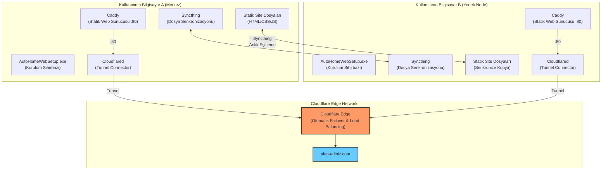
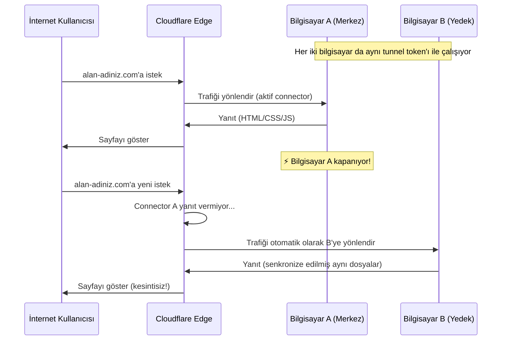
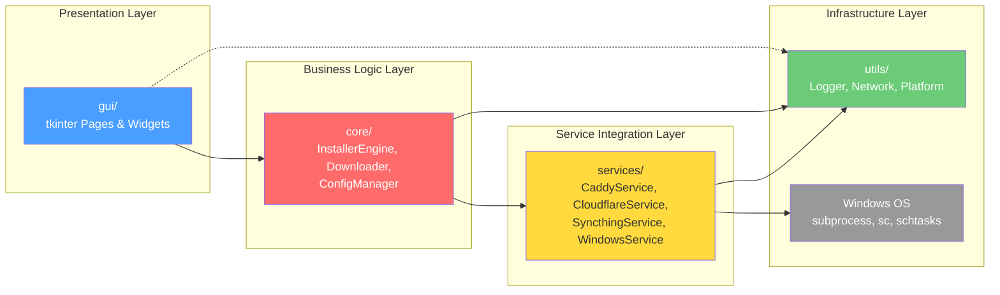
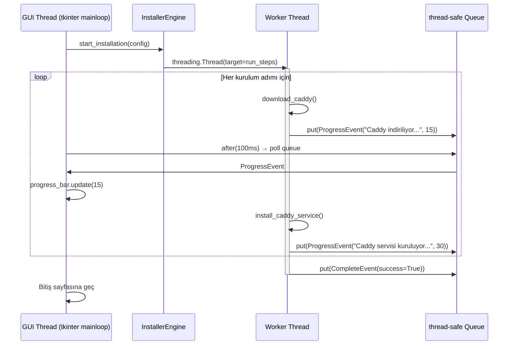
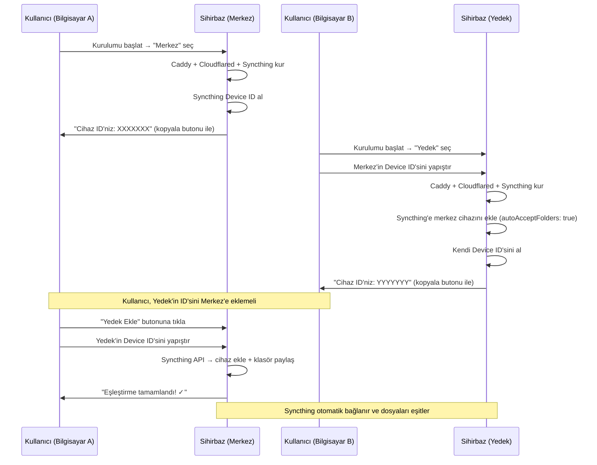
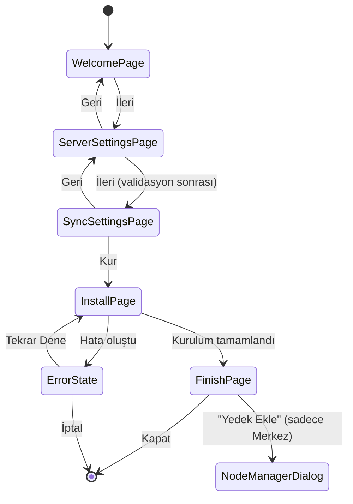
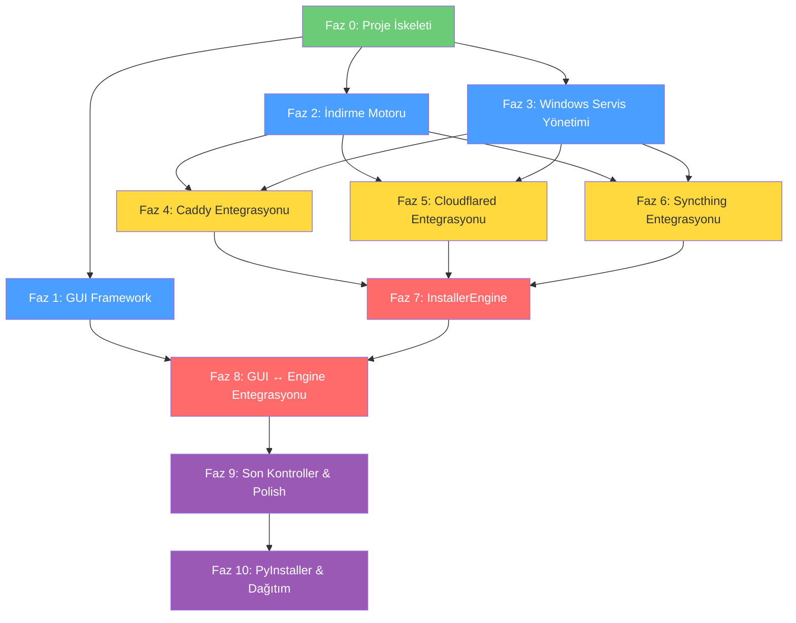

# AutoHomeWebSetup — HA Kurulum Sihirbazı: Proje Geliştirme ve Mimari Planı

> **Vizyon:** Windows kullanıcıları için Kubernetes/Docker Swarm karmaşasına girmeden, "İleri > İleri > Kur" mantığıyla çalışan, evdeki birden fazla bilgisayarı kullanarak statik web siteleri için %100 otonom bir failover ağı kuran masaüstü uygulaması.

---

## 1. Üst Düzey Mimari Genel Bakış



### Failover Akışı



---

## 2. Proje Dizin Yapısı

```
AutoHomeWebSetup/
├── main.py                          # Uygulama giriş noktası, UAC kontrolü
├── app.py                           # Ana Application sınıfı, wizard orkestratörü
├── requirements.txt                 # Python bağımlılıkları
├── build.spec                       # PyInstaller build spesifikasyonu
├── README.md                        # Proje dokümantasyonu
│
├── gui/                             # GUI Katmanı (Presentation Layer)
│   ├── __init__.py
│   ├── theme.py                     # Renk paleti, font, stil sabitleri
│   ├── widgets.py                   # Yeniden kullanılabilir özel tkinter widget'ları
│   ├── base_page.py                 # Tüm sihirbaz sayfaları için temel sınıf
│   ├── pages/                       # Her sihirbaz adımı ayrı bir sayfa
│   │   ├── __init__.py
│   │   ├── welcome_page.py          # 1. Hoşgeldiniz ekranı
│   │   ├── server_settings_page.py  # 2. Web sitesi klasörü + Tunnel token
│   │   ├── sync_settings_page.py    # 3. Merkez/Yedek seçimi + Device ID
│   │   ├── install_page.py          # 4. Kurulum ilerleme ekranı
│   │   └── finish_page.py           # 5. Bitiş + Device ID gösterimi
│   └── dialogs/                     # Modal diyaloglar
│       ├── __init__.py
│       ├── error_dialog.py          # Hata mesaj kutusu
│       └── node_manager_dialog.py   # Merkez bilgisayarda yedek node ekleme diyaloğu
│
├── core/                            # İş Mantığı Katmanı (Business Logic)
│   ├── __init__.py
│   ├── installer.py                 # Ana kurulum orkestratörü (InstallerEngine)
│   ├── downloader.py                # GitHub releases'dan binary indirme
│   ├── config_manager.py            # Uygulama konfigürasyon yönetimi (JSON)
│   └── models.py                    # Veri modelleri (dataclass'lar)
│
├── services/                        # Servis Entegrasyon Katmanı
│   ├── __init__.py
│   ├── caddy_service.py             # Caddy kurulumu, Caddyfile oluşturma, servis kaydı
│   ├── cloudflare_service.py        # Cloudflared kurulumu ve servis kaydı
│   ├── syncthing_service.py         # Syncthing kurulumu, API yönetimi, cihaz eşleştirme
│   └── windows_service.py           # Windows servisleri (sc) ve schtasks yardımcıları
│
├── utils/                           # Yardımcı Araçlar
│   ├── __init__.py
│   ├── constants.py                 # Tüm sabitler (URL, yollar, servis isimleri)
│   ├── logger.py                    # Dosya + GUI tabanlı loglama
│   ├── network.py                   # Ağ yardımcıları (port kontrolü, bağlantı testi)
│   ├── platform_utils.py            # Windows özel: UAC, yönetici kontrolü, path'ler
│   └── resource_path.py             # PyInstaller _MEIPASS uyumlu kaynak yolu çözücü
│
├── assets/                          # Statik kaynaklar (exe'ye gömülecek)
│   ├── icon.ico                     # Uygulama ikonu
│   ├── logo.png                     # Hoşgeldiniz sayfası logosu
│   └── banner.png                   # Sihirbaz banner'ı
│
└── tests/                           # Birim testleri
    ├── __init__.py
    ├── test_downloader.py
    ├── test_config_manager.py
    ├── test_caddy_service.py
    ├── test_cloudflare_service.py
    ├── test_syncthing_service.py
    └── test_windows_service.py
```

---

## 3. Mimari Yaklaşım ve Tasarım Kararları

### 3.1. Katmanlı Mimari (Layered Architecture)



> [!IMPORTANT]
> **GUI → Core → Services → Utils** yönünde tek yönlü bağımlılık. GUI asla doğrudan servis katmanını çağırmaz; her zaman `InstallerEngine` üzerinden iletişim kurar.

### 3.2. Threading Modeli: GUI Donmalarını Engellemek

Tüm uzun süren işlemler (indirme, servis kurulumu, API çağrıları) arka plan thread'lerinde çalışır. GUI thread'i sadece kullanıcı etkileşimlerini ve ekran güncellemelerini yönetir.



**Temel mekanizma:**

```python
# core/installer.py — Basitleştirilmiş konsept
import threading
import queue
from dataclasses import dataclass

@dataclass
class ProgressEvent:
    message: str
    percentage: int
    is_error: bool = False
    is_complete: bool = False

class InstallerEngine:
    def __init__(self):
        self.progress_queue = queue.Queue()
        self._worker_thread = None
        self._cancel_event = threading.Event()
    
    def start(self, config):
        """GUI thread'den çağrılır, worker thread başlatır."""
        self._cancel_event.clear()
        self._worker_thread = threading.Thread(
            target=self._run_installation,
            args=(config,),
            daemon=True  # Ana uygulama kapanınca thread de kapanır
        )
        self._worker_thread.start()
    
    def cancel(self):
        """Kurulumu iptal etmek için sinyal gönder."""
        self._cancel_event.set()
    
    def _run_installation(self, config):
        """Worker thread'de çalışır."""
        try:
            steps = [
                (self._download_caddy,      "Caddy indiriliyor...",       10, 20),
                (self._install_caddy,        "Caddy servisi kuruluyor...", 20, 35),
                (self._download_cloudflared, "Cloudflared indiriliyor...", 35, 50),
                (self._install_cloudflared,  "Cloudflared kuruluyor...",   50, 65),
                (self._download_syncthing,   "Syncthing indiriliyor...",   65, 80),
                (self._install_syncthing,    "Syncthing kuruluyor...",     80, 95),
                (self._finalize,             "Kurulum tamamlanıyor...",    95, 100),
            ]
            for func, msg, start_pct, end_pct in steps:
                if self._cancel_event.is_set():
                    return
                self.progress_queue.put(ProgressEvent(msg, start_pct))
                func(config)
                self.progress_queue.put(ProgressEvent(msg, end_pct))
            
            self.progress_queue.put(ProgressEvent("Kurulum tamamlandı!", 100, is_complete=True))
        except Exception as e:
            self.progress_queue.put(ProgressEvent(str(e), -1, is_error=True))
```

```python
# gui/pages/install_page.py — GUI tarafında queue polling
class InstallPage(BasePage):
    def start_installation(self):
        self.engine.start(self.config)
        self._poll_progress()
    
    def _poll_progress(self):
        """GUI thread'de çalışır, 100ms aralıklarla queue kontrol eder."""
        try:
            while True:
                event = self.engine.progress_queue.get_nowait()
                if event.is_error:
                    self._show_error(event.message)
                    return
                if event.is_complete:
                    self._on_complete()
                    return
                self.progress_bar['value'] = event.percentage
                self.status_label.config(text=event.message)
                self.log_text.insert('end', f"✓ {event.message}\n")
        except queue.Empty:
            pass
        
        # 100ms sonra tekrar kontrol et
        self.after(100, self._poll_progress)
```

> [!TIP]
> **Neden `threading.Thread` + `Queue` ve `after()` polling?**
> - tkinter thread-safe DEĞİLDİR. Widget'lara sadece ana thread'den erişilebilir.
> - `queue.Queue` thread-safe bir iletişim kanalıdır.
> - `widget.after(ms, callback)` tkinter'ın event loop'una güvenli callback ekler.
> - Bu yaklaşım `asyncio`'dan çok daha basit, hata ayıklaması kolay ve tkinter ile doğal uyumludur.

### 3.3. Veri Modeli

```python
# core/models.py
from dataclasses import dataclass, field
from enum import Enum
from typing import Optional

class NodeRole(Enum):
    PRIMARY = "primary"   # Merkez bilgisayar
    SECONDARY = "secondary"  # Yedek bilgisayar (Node)

@dataclass
class InstallConfig:
    """Sihirbaz boyunca toplanan tüm kullanıcı girişleri."""
    # Sayfa 2: Sunucu Ayarları
    site_root_path: str = ""            # Statik site dosyalarının yolu
    cloudflare_token: str = ""          # Cloudflare Tunnel token
    
    # Sayfa 3: Senkronizasyon Ayarları
    node_role: NodeRole = NodeRole.PRIMARY
    primary_device_id: str = ""         # Yedek seçilirse, merkezin Syncthing ID'si
    
    # Otomatik doldurulacaklar
    install_dir: str = r"C:\ProgramData\AutoHomeWebSetup"
    caddy_port: int = 80
    syncthing_api_key: str = ""         # Otomatik üretilecek
    local_device_id: str = ""           # Kurulum sonrası Syncthing'den alınacak

@dataclass
class ServiceStatus:
    """Bir servisin mevcut durumu."""
    name: str
    is_installed: bool = False
    is_running: bool = False
    error: Optional[str] = None
```

### 3.4. Kurulum Dizin Yapısı (Runtime — Kullanıcının Bilgisayarında)

```
C:\ProgramData\AutoHomeWebSetup\
├── bin\
│   ├── caddy.exe
│   ├── cloudflared.exe
│   ├── syncthing.exe
│   └── nssm.exe                # Caddy ve Syncthing'i Windows servisi olarak çalıştırmak için
├── config\
│   ├── Caddyfile               # Caddy konfigürasyonu
│   ├── install_config.json     # Kurulum parametreleri (rollback için)
│   └── syncthing\              # Syncthing --home dizini
│       └── config.xml          # Syncthing konfigürasyonu
├── logs\
│   ├── installer.log           # Kurulum logu
│   ├── caddy.log
│   └── syncthing.log
└── site\                       # (Yedek node'da) Senkronize edilen site dosyaları
```

---

## 4. Servis Entegrasyonları — Teknik Detaylar

### 4.1. Caddy Entegrasyonu

| Özellik | Detay |
|---------|-------|
| İndirme | GitHub Releases API → `caddy_vX.Y.Z_windows_amd64.zip` |
| Konfigürasyon | Otomatik `Caddyfile` oluşturma |
| Servis Kaydı | NSSM wrapper ile Windows Servisi kaydı (SCM hook uyumsuzluğunu önlemek için) |
| Port | Varsayılan `:80`, çakışma kontrolü yapılacak |

**Üretilecek Caddyfile:**
```
:80 {
    root * C:\Users\kullanici\my-website
    file_server
    encode gzip
    log {
        output file C:\ProgramData\AutoHomeWebSetup\logs\caddy.log
    }
}
```

### 4.2. Cloudflared Entegrasyonu

| Özellik | Detay |
|---------|-------|
| İndirme | GitHub Releases → `cloudflared-windows-amd64.exe` (tek dosya) |
| Kurulum | `cloudflared.exe service install <TOKEN>` (kendi servisini kurar) |
| Failover | Aynı token ile birden fazla connector → Cloudflare otomatik failover |

> [!NOTE]
> Cloudflared, `service install` komutu ile kendi Windows servisini oluşturur. Ekstra `sc create` veya NSSM gerekmez. Bu, kurulumu son derece basitleştirir.

### 4.3. Syncthing Entegrasyonu

| Özellik | Detay |
|---------|-------|
| İndirme | GitHub Releases → `syncthing-windows-amd64-vX.Y.Z.zip` |
| API | REST API @ `http://127.0.0.1:8384` + `X-API-Key` header |
| Servis Kaydı | NSSM ile Windows servisi olarak çalıştırma (`-no-browser -no-restart` argümanlarıyla) |
| Cihaz Eşleştirme | İki yönlü (Mutual Trust): her iki cihaz birbirinin ID'sini bilmeli |

**Eşleştirme Akışı (İki Aşamalı — UX Odaklı):**



> [!IMPORTANT]
> **Neden iki aşamalı?** Syncthing güvenlik gereği karşılıklı (mutual TLS / fingerprint) onay ister. Merkez bilgisayarda "Yedek Ekle" butonu/diyaloğu, kurulum sonrası ana uygulamaya erişilebilir bir yönetim paneli işlevi görür. Bu, güvenli ve kullanıcı dostu bir yaklaşımdır.

### 4.4. NSSM (Non-Sucking Service Manager) Yaklaşımı

Cloudflared kendi servisini kurabilir. Ancak **Caddy ve Syncthing doğrudan `sc create` ile başlatıldıklarında Windows Service Control Manager (SCM) API sinyallerine yanıt vermediklerinden hata verip (Örn: Error 1053) zaman aşımına uğrarlar**. Bu nedenle her iki servis için de NSSM kullanıyoruz:

```python
# services/windows_service.py — NSSM wrapper
class NSSMService:
    def __init__(self, nssm_path: str):
        self.nssm = nssm_path
    
    def install(self, name, exe_path, arguments=""):
        subprocess.run([self.nssm, "install", name, exe_path, arguments], check=True, creationflags=subprocess.CREATE_NO_WINDOW)
    
    def set_param(self, name, param, value):
        subprocess.run([self.nssm, "set", name, param, value], check=True, creationflags=subprocess.CREATE_NO_WINDOW)
    
    def start(self, name):
        subprocess.run([self.nssm, "start", name], check=True, creationflags=subprocess.CREATE_NO_WINDOW)
```

> [!TIP]
> NSSM binary'si (~300KB) PyInstaller ile exe içine gömülebilir veya kurulum sırasında indirilebilir. Boyutu çok küçük olduğundan doğrudan exe'ye gömmek en mantıklı seçenektir.
> **Not:** GUI uygulamalarında terminal pencerelerinin belirmemesi için tüm `subprocess.run` çağrılarına `creationflags=subprocess.CREATE_NO_WINDOW` eklenmelidir.

---

## 5. GUI Sihirbaz Akışı — Detaylı Tasarım

### Sayfa Geçiş Diyagramı



### Sayfa Detayları

| Sayfa | Widget'lar | Validasyon |
|-------|-----------|------------|
| **1. Hoşgeldiniz** | Logo, açıklama metni, İleri butonu | — |
| **2. Sunucu Ayarları** | Klasör seçici (filedialog), Token girişi (Entry), port ayarı (Spinbox) | Klasör var mı? İçinde `index.html` var mı? Token boş mu? Port kullanımda mı? |
| **3. Senkronizasyon** | RadioButton (Merkez/Yedek), Syncthing Device ID girişi (Yedek seçilirse), Device ID format validasyonu | Yedek seçilirse: Device ID formatı geçerli mi? (`[A-Z0-9]{7}-...` formatında 8 grup) |
| **4. Kurulum** | ProgressBar, durum etiketi, log alanı (ScrolledText), İptal butonu | — |
| **5. Bitiş** | Başarı mesajı, Device ID gösterimi + kopyala butonu, "Yedek Ekle" butonu (Merkez ise), Kapat butonu | — |

### Wizard Framework (BasePage)

```python
# gui/base_page.py
import tkinter as tk

class BasePage(tk.Frame):
    """Tüm sihirbaz sayfaları için temel sınıf."""
    
    def __init__(self, parent, controller):
        super().__init__(parent)
        self.controller = controller  # App sınıfı referansı
    
    def validate(self) -> tuple[bool, str]:
        """Sayfa geçiş validasyonu. Alt sınıflar override eder."""
        return True, ""
    
    def on_enter(self):
        """Sayfa gösterildiğinde çağrılır. Alt sınıflar override eder."""
        pass
    
    def on_leave(self):
        """Sayfadan ayrılırken çağrılır. Alt sınıflar override eder."""
        pass
    
    def get_data(self) -> dict:
        """Sayfadaki kullanıcı verilerini döndürür."""
        return {}
```

---

## 6. Kritik Noktalar ve Riskler

### 6.1. Windows UAC (Yönetici Yetkileri)

| Risk | Etki | Çözüm |
|------|------|-------|
| `sc create`, `nssm install` yönetici yetkisi gerektirir | Kurulum başarısız olur | PyInstaller `--uac-admin` flag'i ile manifest'e `requireAdministrator` eklenir. Ayrıca runtime'da `ctypes.windll.shell32.IsUserAnAdmin()` kontrolü yapılır. |
| UAC prompt'u kullanıcıyı korkutabilir | Kullanıcı deneyimi bozulur | Hoşgeldiniz sayfasında "Bu program servisleri kaydetmek için yönetici yetkisi gerektirir" uyarısı gösterilir. |
| PyInstaller ile UAC manifest bazen çalışmaz | exe yönetici olmadan açılır | `.spec` dosyasında `uac_admin=True` ile birlikte `manifest` dosyası da gömülür. |

**Runtime kontrol kodu:**
```python
# main.py
import ctypes
import sys
import subprocess

def is_admin():
    try:
        return ctypes.windll.shell32.IsUserAnAdmin() != 0
    except Exception:
        return False

def elevate():
    """Yönetici olarak yeniden başlat."""
    ctypes.windll.shell32.ShellExecuteW(
        None, "runas", sys.executable, " ".join(sys.argv), None, 1
    )
    sys.exit(0)

if __name__ == "__main__":
    if not is_admin():
        elevate()
    # ... uygulama başlat
```

### 6.2. Antivirüs False Positive Sorunları

| Risk | Çözüm |
|------|-------|
| PyInstaller exe'leri genellikle Windows Defender/AV tarafından şüpheli işaretlenir | UPX sıkıştırmasını devre dışı bırak (`upx=False`). |
| İndirilen binary'ler (caddy, cloudflared, syncthing) karantinaya alınabilir | İndirme sonrası dosya hash'ini (SHA256) GitHub releases'daki checksum ile doğrula. Kullanıcıyı önceden bilgilendir. |
| `subprocess` ile servis kaydı davranışsal tespit tetikleyebilir | İşlemleri adım adım yapıp her adımda log tut. Hata durumunda anlamlı mesaj göster. |
| SmartScreen "bilinmeyen yayımcı" uyarısı | Mümkünse code signing sertifikası kullan. Değilse kullanıcıyı bilgilendir. |

> [!WARNING]
> **Antivirüs en büyük UX riskidir.** Hoşgeldiniz sayfasında ve README'de "Antivirüsünüzde istisna eklemeniz gerekebilir" uyarısı mutlaka yer almalıdır. İndirilen her binary'nin SHA256 hash doğrulaması yapılmalıdır.

### 6.3. Syncthing Cihaz Eşleştirme Riskleri

| Risk | Çözüm |
|------|-------|
| Syncthing başlatılmadan API çağrılırsa hata alınır | Syncthing başlatıldıktan sonra API'ye bağlanana kadar polling yap (retry with backoff, max 30 saniye). |
| Device ID yanlış formatta girilirse | Regex ile format validasyonu: `^[A-Z0-9]{7}(-[A-Z0-9]{7}){7}$` |
| İki cihaz birbirini görmezse (NAT/Firewall) | Syncthing global discovery ve relay sunucularını etkin bırak. Kullanıcıyı bilgilendir. |
| `autoAcceptFolders` güvenlik riski | Sadece bilinen, eşleştirilmiş cihazlar için etkinleştir. Genel auto-accept asla kullanılmaz. |

### 6.4. Port Çakışmaları

| Port | Kullanıcı | Risk | Çözüm |
|------|-----------|------|-------|
| 80 | Caddy | IIS, Apache, başka web sunucusu çalışıyor olabilir | Kurulum öncesi `netstat`/socket kontrolü. Meşgulse kullanıcıya alternatif port sor. |
| 8384 | Syncthing API | Başka bir Syncthing instance | Özel port atanır ve `config.xml`'de yapılandırılır (Örn: `8385`). |

**Port kontrol fonksiyonu:**
```python
# utils/network.py
import socket

def is_port_available(port: int, host: str = "127.0.0.1") -> bool:
    with socket.socket(socket.AF_INET, socket.SOCK_STREAM) as s:
        try:
            s.bind((host, port))
            return True
        except OSError:
            return False
```

### 6.5. PyInstaller Paketleme ve `sys._MEIPASS` Dikkat Noktaları

| Konu | Detay |
|------|-------|
| `sys._MEIPASS` ve Windows Servisleri | `--onefile` modunda uygulama çalışırken exe içeriği `%TEMP%` altında geçici bir klasöre açılır. Uygulama kapandığında bu klasör **SİLİNİR**. Bu nedenle, asla `_MEIPASS` altındaki bir exe'yi Windows servisi olarak kaydetmeyin! Kurulum esnasında gömülü araçlar (Örn: `nssm.exe`) önce kalıcı dizine (`C:\ProgramData\AutoHomeWebSetup\bin\`) kopyalanmalıdır. |
| Hidden imports | `tkinter` ve sub- modülleri bazen eksik kalabilir: `--hidden-import=tkinter.filedialog` |
| `requests` kütüphanesi | SSL sertifikaları sorun çıkarabilir: `certifi` paketini dahil et. |
| Terminal pencereleri | `--windowed` kullanıldığında, alt program (subprocess) çalıştırmaları terminal penceresi açabilir. Hepsinde `creationflags=subprocess.CREATE_NO_WINDOW` kullanılmalı. |

**Build komutu:**
```bash
pyinstaller --onefile --windowed --name AutoHomeWebSetup --icon=assets/icon.ico --uac-admin main.py
```

### 6.6. Rollback (Geri Alma) Mekanizması

> [!CAUTION]
> Kurulum yarıda kalırsa (hata, iptal, elektrik kesintisi), sistem tutarsız durumda kalabilir. Rollback mekanizması **zorunludur**.

```python
# core/installer.py — Rollback mantığı
class InstallerEngine:
    def __init__(self):
        self._completed_steps: list[str] = []  # Tamamlanan adımlar
    
    def _run_installation(self, config):
        try:
            self._download_and_install_caddy(config)
            self._completed_steps.append("caddy")
            
            self._download_and_install_cloudflared(config)
            self._completed_steps.append("cloudflared")
            
            self._download_and_install_syncthing(config)
            self._completed_steps.append("syncthing")
        except Exception as e:
            self._rollback()
            raise
    
    def _rollback(self):
        """Tamamlanan adımları ters sırada geri al."""
        for step in reversed(self._completed_steps):
            try:
                if step == "caddy":
                    self._uninstall_caddy()
                elif step == "cloudflared":
                    self._uninstall_cloudflared()
                elif step == "syncthing":
                    self._uninstall_syncthing()
            except Exception:
                pass  # Rollback hataları loglanır ama yutulur
```

### 6.7. Kaldırma (Uninstaller) Desteği

V1'de tam bir kaldırıcı sihirbazı zorunlu olmasa da `install_config.json` dosyasında tüm yapılan işlemler kaydedilmeli ve ileride temiz kaldırma yapılabilmesine olanak sağlanmalıdır:

```json
{
  "installed_services": ["AutoHomeWebSetup-Caddy", "Cloudflared", "AutoHomeWebSetup-Syncthing"],
  "created_directories": ["C:\\ProgramData\\AutoHomeWebSetup"],
  "install_date": "2026-08-06T16:23:00",
  "node_role": "primary",
  "caddy_port": 80
}
```

---

## 7. Adım Adım Otonom Geliştirme Planı (Fazlar)

> Her faz, bir AI kodlama asistanının (Cline, Cursor, vb.) kafası karışmadan bağımsız olarak geliştirebileceği ve test edebileceği mantıksal birimlere bölünmüştür.

---

### Faz 0: Proje İskeleti ve Altyapı (Temel)
**Bağımlılık:** Yok  
**Tahmini Süre:** 30 dakika  
**Test:** `python main.py` çalıştırılınca yönetici haklarıyla boş bir tkinter penceresi açılmalı.

**Yapılacaklar:**
- [ ] Proje dizin yapısını oluştur (tüm `__init__.py` dosyaları dahil)
- [ ] `requirements.txt` oluştur: `requests`, `pyinstaller`
- [ ] `utils/constants.py`: Tüm sabitler (URL'ler, dizin yolları, servis isimleri, varsayılan portlar)
- [ ] `utils/resource_path.py`: `resource_path()` fonksiyonu (PyInstaller `_MEIPASS` uyumlu)
- [ ] `utils/platform_utils.py`: `is_admin()`, `elevate()`, `get_install_dir()` fonksiyonları
- [ ] `utils/logger.py`: Dosyaya ve GUI'ye log gönderen logger
- [ ] `core/models.py`: `InstallConfig`, `NodeRole`, `ProgressEvent`, `ServiceStatus` dataclass'ları
- [ ] `main.py`: UAC kontrolü + uygulama başlatma
- [ ] `app.py`: Boş tkinter penceresi (sadece başlık ve boyut)

---

### Faz 1: GUI Framework ve Wizard Yapısı
**Bağımlılık:** Faz 0  
**Tahmini Süre:** 1.5 saat  
**Test:** Sayfalar arası İleri/Geri geçiş çalışmalı.

**Yapılacaklar:**
- [ ] `gui/theme.py`: Renk paleti (koyu tema), fontlar, padding sabitleri
- [ ] `gui/widgets.py`: Özel widget'lar — `StyledButton`, `StyledEntry`, `StyledLabel`, `HeaderFrame`
- [ ] `gui/base_page.py`: `BasePage` sınıfı (`validate`, `on_enter`, `on_leave`, `get_data`)
- [ ] `app.py`: Wizard framework — sayfa yığını (stack), `show_page()`, `next_page()`, `prev_page()`
- [ ] `gui/pages/welcome_page.py`: Hoşgeldiniz metni + logo alanı
- [ ] `gui/pages/server_settings_page.py`: Klasör seçici + Tunnel Token girişi + Port ayarı
- [ ] `gui/pages/sync_settings_page.py`: RadioButton (Merkez/Yedek) + koşullu Device ID girişi
- [ ] `gui/pages/install_page.py`: ProgressBar + durum etiketi + log ScrolledText (sadece UI)
- [ ] `gui/pages/finish_page.py`: Başarı mesajı + Device ID gösterimi (placeholder)

---

### Faz 2: İndirme Motoru (Downloader)
**Bağımlılık:** Faz 0  
**Tahmini Süre:** 1 saat  
**Test:** Caddy, Cloudflared, Syncthing ve NSSM binary'leri başarıyla indirilmeli veya açılmalı.

**Yapılacaklar:**
- [ ] `core/downloader.py`: `Downloader` sınıfı
  - `download_file(url, dest, progress_callback)`: Chunk-based indirme + ilerleme yüzdesi
  - `download_caddy(install_dir)`: GitHub Releases API → zip → extract `caddy.exe`
  - `download_cloudflared(install_dir)`: GitHub Releases → `cloudflared.exe`
  - `download_syncthing(install_dir)`: GitHub Releases → zip → extract `syncthing.exe`
  - `setup_nssm(install_dir)`: Gömülü `nssm.exe`'yi `_MEIPASS`'tan kalıcı dizine kopyala
  - Her indirme sonrası SHA256 hash doğrulaması
- [ ] Hata yönetimi: Ağ hatası, zaman aşımı, eksik dosya kontrolü ve 3 kez exponential backoff retry

---

### Faz 3: Windows Servis Yönetimi
**Bağımlılık:** Faz 0  
**Tahmini Süre:** 45 dakika  
**Test:** Dummy bir servis NSSM veya SC ile oluşturulup durdurulabilmeli.

**Yapılacaklar:**
- [ ] `services/windows_service.py`:
  - `SCService` sınıfı: `create()`, `start()`, `stop()`, `delete()`, `query()`
  - `NSSMService` sınıfı: `install()`, `set_param()`, `start()`, `stop()`, `remove()` — NSSM wrapper'ı
  - `is_service_installed(name)` & `is_service_running(name)` yardımcı fonksiyonları
- [ ] Tüm `subprocess.run` çağrılarına mutlaka `creationflags=subprocess.CREATE_NO_WINDOW` eklenmeli.

---

### Faz 4: Caddy Servis Entegrasyonu
**Bağımlılık:** Faz 2, Faz 3  
**Tahmini Süre:** 45 dakika  
**Test:** Caddy indirilip NSSM ile servis olarak kurulmalı, localhost:80'de statik site sunmalı.

**Yapılacaklar:**
- [ ] `services/caddy_service.py`: `CaddyService` sınıfı
  - `generate_caddyfile(site_root, port, log_path)`: Caddyfile oluştur ve kaydet
  - `install(install_dir, site_root, port)`: NSSM ile `caddy run --config ...` servisini kaydet ve başlat
  - `uninstall()`: Servisi durdur ve sil
- [ ] `utils/network.py`: `is_port_available(port)` fonksiyonu ve port çakışma kontrolü

---

### Faz 5: Cloudflared Servis Entegrasyonu
**Bağımlılık:** Faz 2, Faz 3  
**Tahmini Süre:** 30 dakika  
**Test:** Cloudflared servis olarak kurulmalı (geçerli token ile).

**Yapılacaklar:**
- [ ] `services/cloudflare_service.py`: `CloudflareService` sınıfı
  - `install(install_dir, token)`: `cloudflared service install <token>` çalıştır (NSSM gerekmez)
  - `uninstall()`: `cloudflared service uninstall` çalıştır
  - `validate_token(token)`: Token format kontrolü

---

### Faz 6: Syncthing Servis Entegrasyonu
**Bağımlılık:** Faz 2, Faz 3  
**Tahmini Süre:** 1.5 saat  
**Test:** Syncthing çalışmalı, REST API erişilebilir olmalı, Device ID alınabilmeli.

**Yapılacaklar:**
- [ ] `services/syncthing_service.py`: `SyncthingService` sınıfı
  - `generate_initial_config(home_dir, api_key, gui_port)`: İlk yapılandırmayı üret ve `config.xml` güncelle
  - `install_as_service(install_dir, home_dir)`: NSSM ile Windows servisi oluştur (`-no-browser -home=...`) ve başlat
  - `wait_for_api(timeout=30)`: API erişilebilir olana kadar bekle
  - `get_device_id()`: `GET /rest/system/status` → `myID`
  - `add_device(device_id, name, auto_accept=True)`: `POST /rest/config/devices`
  - `share_folder(folder_id, folder_path, device_ids)`: `POST /rest/config/folders`
  - `uninstall()`: NSSM ile servisi durdur ve sil

---

### Faz 7: Kurulum Motoru (InstallerEngine) — Bütünleştirme
**Bağımlılık:** Faz 4, Faz 5, Faz 6  
**Tahmini Süre:** 1 saat  
**Test:** Tam kurulum akışı CLI'dan simüle edilebilmeli.

**Yapılacaklar:**
- [ ] `core/installer.py`: `InstallerEngine` sınıfı
  - `progress_queue`: Thread-safe ilerleme kuyruğu (`Queue`)
  - `start(config: InstallConfig)`: Worker thread başlat
  - `_run_installation(config)`: Sıralı kurulum adımları ve canlı yüzdelik artışı
  - `_rollback()`: Hata durumunda yapılan işlemleri geri al
  - Merkez vs Yedek ayrımı (Yedek node'da `autoAcceptFolders=true` ve hedef dizin ayarlanması)
- [ ] `core/config_manager.py`: `install_config.json` kaydet/yükle

---

### Faz 8: GUI ↔ InstallerEngine Entegrasyonu
**Bağımlılık:** Faz 1, Faz 7  
**Tahmini Süre:** 1 saat  
**Test:** GUI üzerinden tam kurulum akışı çalışıp canlı ilerleme göstermeli.

**Yapılacaklar:**
- [ ] `gui/pages/install_page.py`: `_poll_progress()` (100ms polling) mekanizmasını bağla
  - İlerleme çubuğu ve log metin alanını worker thread sinyalleriyle besle
  - Hata durumunda hata diyaloğu çıkarma, iptal butonu işlevi
- [ ] `gui/pages/finish_page.py`: Syncthing Device ID'yi göster + kopyala butonu
- [ ] `gui/dialogs/node_manager_dialog.py`: "Yedek Ekle" diyaloğu (Merkez bilgisayardan sonrasında cihaz bağlayabilmek için)
- [ ] `app.py`: Tüm sayfa verilerini `InstallConfig` objesine aktarma

---

### Faz 9: Son Kontroller, Hata İyileştirmesi ve Polish
**Bağımlılık:** Faz 8  
**Tahmini Süre:** 1.5 saat  
**Test:** Uçtan uca senaryolar ve edge-case kontrolleri.

**Yapılacaklar:**
- [ ] Tüm hata senaryolarını gözden geçir ve kullanıcı dostu mesajlar ekle (İnternet kopması, port doluluğu vb.)
- [ ] Logların hem dosya (`C:\ProgramData\AutoHomeWebSetup\logs\installer.log`) hem de ekrana yazılmasının garantisi
- [ ] GUI iyileştirmeleri: Minimum pencere boyutu kilidi, responsive widget'lar

---

### Faz 10: PyInstaller Paketleme ve Dağıtım
**Bağımlılık:** Faz 9  
**Tahmini Süre:** 1 saat  
**Test:** Temiz Windows'ta tek `.exe` dosyasının çalışması.

**Yapılacaklar:**
- [ ] `build.spec` dosyasını oluştur ve yapılandır:
  - `onefile=True`, `windowed=True`, `uac_admin=True`
  - `upx=False` (antivirüs uyarılarını önlemek için zorunlu)
  - `nssm.exe`, `icon.ico`, logo gibi statik asset'leri datas içine dahil etme
- [ ] Temiz Windows ortamında UAC istemi, virüs uyarıları ve servis başlatma testi

---

## 8. Faz Bağımlılık Grafiği



---

## 9. Teknoloji Yığını Özeti

| Katman | Teknoloji | Neden? |
|--------|-----------|--------|
| **GUI** | Python tkinter | Standart kütüphane, ek bağımlılık yok, PyInstaller ile mükemmel uyumlu |
| **İş Mantığı** | Python 3.10+ | Tip güvenliği (`dataclasses`, `typing`), güçlü hata yönetimi |
| **HTTP İstemci** | `requests` & `urllib` | İndirme + Syncthing REST API iletişimi |
| **Threading** | `threading` + `queue.Queue` | tkinter ile donma yaşatmayan asenkron haberleşme |
| **Windows Servisleri** | `subprocess` + `nssm.exe` | Caddy ve Syncthing'in native servis kanca (SCM hook) eksikliğini çözmek için |
| **Web Sunucu** | Caddy | Sıfır bağımlılıklı, son derece hafif ve modern web sunucusu |
| **Tunnel (Failover)**| Cloudflared | Port açmadan dış dünyaya bağlantı ve Edge seviyesinde %100 otonom failover |
| **Senkronizasyon** | Syncthing | Merkezsiz, hafif, çift yönlü TLS ve güçlü REST API destekli senkronizasyon |
| **Paketleme** | PyInstaller | Tek `.exe` dağıtımı ve manifest düzeyinde UAC yönetimi (`--uac-admin`) |
